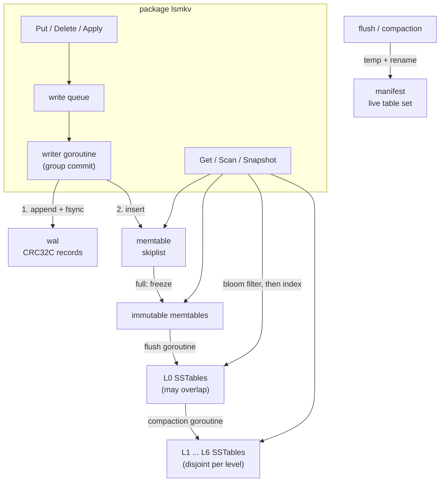

# lsmkv

An embeddable key-value storage engine for Go, built on a log-structured
merge tree. It is a library first (`import "github.com/nikrybak/lsmkv"`), with
a small CLI and an optional HTTP mode for demos.

The goal is a storage engine that is small enough to read in an afternoon but
does the parts that are usually skipped: checksummed on-disk formats, crash
recovery that distinguishes a torn write from real corruption, group commit,
snapshot-aware compaction, and reference-counted table sets so that background
work never blocks or breaks a reader.

```go
db, err := lsmkv.Open("data", lsmkv.WithSyncPolicy(lsmkv.SyncAlways))
if err != nil { ... }
defer db.Close()

_ = db.Put([]byte("user:1"), []byte("alice"))
v, err := db.Get([]byte("user:1"))          // err is lsmkv.ErrNotFound if absent

var b lsmkv.Batch                            // atomic, survives a crash as a unit
b.Put([]byte("user:2"), []byte("bob"))
b.Delete([]byte("user:1"))
_ = db.Apply(&b)

snap, _ := db.Snapshot()                     // consistent point-in-time view
defer snap.Release()

it, _ := db.Scan(lsmkv.Prefix([]byte("user:")))
defer it.Close()
for it.Next() {
    fmt.Printf("%s=%s\n", it.Key(), it.Value())
}
if err := it.Err(); err != nil { ... }
```

A runnable version lives in [`examples/basic`](examples/basic/main.go).

## Architecture



| Package               | Responsibility                                                                 |
|-----------------------|--------------------------------------------------------------------------------|
| `lsmkv`               | Public API, write pipeline, recovery, flush/compaction orchestration, versions |
| `internal/base`       | Internal key encoding (user key + seq/kind trailer), ordering, `ErrCorrupt`    |
| `internal/wal`        | Log writer with sync policies, replay with torn-tail detection                 |
| `internal/memtable`   | Single-writer, lock-free-reader skiplist                                       |
| `internal/sstable`    | Block format, table writer, two-level table reader                             |
| `internal/bloom`      | Bloom filter builder and probe                                                 |
| `internal/iterator`   | Iterator contract, k-way merging iterator, lazy concatenating iterator         |
| `internal/manifest`   | Table metadata, immutable versions and edits, atomic persistence               |
| `internal/compaction` | Leveled picker and the snapshot-aware merge filter                             |

Layers talk through small interfaces: every source of entries implements
`iterator.Iterator`, compaction writes through a two-method `Sink`, and the
SSTable reader needs only an `io.ReaderAt`. There is no global state; all
configuration is passed with functional options.

### Internal keys and sequence numbers

Every write gets a 56-bit sequence number. Internally a key is stored as
`user key | uint64(seq << 8 | kind)` and ordered by user key ascending, then
trailer descending, so the newest version of a key is always met first.
Snapshots, tombstones, batch atomicity and compaction all fall out of this
ordering: a reader at sequence `S` simply takes the first entry with
`seq <= S` for each user key.

## Write path

1. `Put`, `Delete` and `Apply` encode a batch and hand it to the single writer
   goroutine over an unbuffered channel.
2. The writer takes one request and drains everything else already queued
   (up to 256 requests or 4 MiB). This is **group commit**: the whole group is
   appended to the WAL and made durable with one `fsync`.
3. Batches are applied to the memtable, then the visible sequence number is
   published with one atomic store, so a reader sees all of a batch or none.
4. When the memtable reaches its size limit it is frozen, a new WAL file is
   started, and the flush goroutine writes the frozen memtable to a level-0
   SSTable. If too many memtables are waiting or level 0 has too many tables,
   the writer stalls: bounded memory and read amplification are preferred
   over unbounded queues.

## Read path

`Get` pins the current memtable, the frozen memtables and the current table
set (one short mutex section and a reference count), then searches without
locks:

1. active memtable, then frozen memtables newest to oldest;
2. level-0 tables newest to oldest, skipping tables whose key range or bloom
   filter excludes the key;
3. one table per deeper level, found by binary search over table key ranges,
   again gated by the bloom filter;
4. inside a table: binary search over the index block, then over the restart
   points of one data block.

The first version found decides the answer; a tombstone ends the search with
`ErrNotFound`. `Scan` merges the same sources with a heap-based k-way merging
iterator and opens deeper-level tables lazily as the scan reaches them.

## Compaction

lsmkv uses **leveled compaction**:

- Level 0 receives flushed memtables, so its tables may overlap. When it has
  `L0CompactionTrigger` (default 4) tables, all of them are merged with the
  overlapping tables of level 1.
- Levels 1 to 6 hold disjoint tables. Level `n` has a budget of
  `10 MiB * 10^(n-1)`. The level furthest over budget pushes one table, chosen
  round-robin across the key space, into the next level, merging it with the
  overlapping tables there. A table with no overlap below is moved by a
  manifest edit without being rewritten.
- Output is split into tables of about 2 MiB, but only at user-key boundaries,
  so every version of a key stays in one table and levels stay disjoint.

Why leveled rather than size-tiered: it bounds the number of tables a read can
touch (level-0 tables plus one per level) and keeps space amplification near
1.1x, which suits read-heavy and point-lookup-heavy embedded use. The cost is
higher write amplification, since data is rewritten once per level.

While merging, the compaction filter walks each user key's versions newest
first and drops:

- **shadowed versions**: a newer version of the same key is already visible to
  the oldest live snapshot, so no reader can reach past it;
- **expired tombstones**: a tombstone visible to every snapshot in a
  bottommost compaction, where no deeper level can hold data it must hide.

Flushes run through the same filter, so a hot key rewritten thousands of times
in one memtable costs one entry on disk.

Compaction never blocks reads. Inputs are read through their own iterators,
outputs are written to new files, and the result is installed by writing a new
manifest and swapping a pointer. Table sets are immutable, reference-counted
versions: an input table is closed and deleted only when the last version
(and therefore the last iterator or `Get`) using it is released.

## On-disk formats

A database directory contains `MANIFEST`, numbered `NNNNNN.log` WAL files and
numbered `NNNNNN.sst` tables. All integers are little-endian; checksums are
CRC-32C (Castagnoli).

### WAL record

```
+-------------+--------------+---------------------+
| crc32c  u32 | length   u32 | payload (length)    |
+-------------+--------------+---------------------+
crc covers length and payload

payload = first seq u64 | op count u32 | op*
op      = kind u8 | key len uvarint | key | [value len uvarint | value]  (value only for puts)
```

One record holds one batch, which is why batches are atomic across crashes.

### SSTable (format version 1)

```
+-------------------------+
| data block 0  | crc32c  |
| ...                     |
| data block N  | crc32c  |
+-------------------------+
| filter block  | crc32c  |   bloom filter over user keys, last byte = probe count
+-------------------------+
| index block   | crc32c  |   per data block: last internal key -> (offset, length) uvarints
+-------------------------+
| footer, 48 bytes        |
+-------------------------+

block  = entry* | restart offset u32 * R | R u32
entry  = shared prefix uvarint | unshared uvarint | value len uvarint | key suffix | value
footer = index off u64 | index len u64 | filter off u64 | filter len u64
       | version u32 | crc32c(previous 36 bytes) u32 | magic u64 ("LSMKVTB1")
```

Keys are prefix-compressed against the previous key, with a full key every 16
entries (a restart point) so lookups can binary-search inside a block. Every
block is checksummed and every length is bounds-checked before use; the block
decoder and table opener are fuzzed against arbitrary input.

### Manifest

```
"LSMKVMF1" | payload length u32 | payload | crc32c(payload) u32

payload = next file number | log number | last sequence | table count
        | (level | file number | size | smallest key | largest key)*
```

The manifest is rewritten whole on every flush or compaction:
write `MANIFEST.tmp`, fsync, rename over `MANIFEST`, fsync the directory. The
rename is atomic, so a crash leaves the old or the new table set, never a mix.
For an embedded store with hundreds of tables the rewrite is a few kilobytes;
it avoids the log-compaction machinery an append-only manifest needs.

## Durability and recovery

| Policy                  | Acknowledged write survives a process crash | survives power loss               |
|-------------------------|---------------------------------------------|-----------------------------------|
| `SyncAlways` (default)  | yes                                         | yes                               |
| `SyncInterval(d)`       | yes                                         | all but the last `d` (100 ms)     |
| `SyncNone`              | yes                                         | whatever the OS had flushed       |

Records are handed to the OS on every commit regardless of policy; the policy
only decides when `fsync` runs. Under `SyncAlways`, concurrent writers share
fsyncs through group commit.

On `Open`:

1. The manifest is loaded and checksum-verified, and every live table is
   opened (footer, index and filter checksums are verified).
2. Tables not named by the manifest (a crash between writing a table and
   installing it) and WAL files older than the manifest's log number are
   deleted.
3. Remaining WAL files are replayed in order. A damaged **final** record is
   the footprint of a crash mid-append and is discarded with a warning.
   Damage followed by more data cannot come from a torn append, so it fails
   `Open` with an error wrapping `ErrCorrupt` instead of silently dropping
   acknowledged writes.
4. Replayed data is written to level-0 tables, a new manifest is installed,
   and the replayed logs are removed.

Errors are typed: `ErrNotFound`, `ErrClosed` and `ErrCorrupt` work with
`errors.Is` no matter which layer detected the problem.

## Concurrency model

- **Writers**: any number of goroutines may call `Put`, `Delete` and `Apply`;
  they are serialised by the writer goroutine, which is the only code that
  touches the WAL and inserts into the memtable.
- **Readers**: `Get`, `Scan` and snapshots take `db.mu` only to pin the current
  memtables and version, then read without locks. The skiplist supports one
  writer with lock-free readers (nodes are published with atomic pointer
  stores, bottom level first).
- **Background**: one flush goroutine and one compaction goroutine. They build
  tables without holding `db.mu`; installs are serialised by a separate
  `installMu`, so the manifest fsync never blocks readers.
- `db.mu` is never held across disk I/O.

Iterators and snapshots are not safe for concurrent use themselves and must be
released before `Close`.

## Library options

| Option                                | Default    | Meaning                                         |
|---------------------------------------|------------|-------------------------------------------------|
| `WithSyncPolicy(p)`                   | SyncAlways | WAL durability policy                           |
| `WithSyncInterval(d)`                 | 100 ms     | selects `SyncInterval` with period `d`          |
| `WithMemtableSize(n)`                 | 4 MiB      | memtable size that triggers a flush             |
| `WithMaxImmutableMemtables(n)`        | 2          | frozen memtables before writes stall            |
| `WithBlockSize(n)`                    | 4 KiB      | SSTable data block size                         |
| `WithBloomBitsPerKey(n)`              | 10         | bloom filter density, 0 disables                |
| `WithL0CompactionTrigger(n)`          | 4          | level-0 tables that trigger compaction          |
| `WithL0StopWritesTrigger(n)`          | 12         | level-0 tables at which writes stall            |
| `WithLevelSizes(base, multiplier)`    | 10 MiB, 10 | level budgets                                   |
| `WithTargetFileSize(n)`               | 2 MiB      | compaction output table size                    |
| `WithLogger(l)`                       | discard    | `slog` logger for background events             |

`db.Flush()` forces the memtable to disk and `db.Stats()` reports per-level
table counts and sizes, flush and compaction counters, write stalls and bloom
filter skips.

## CLI and HTTP mode

```
go run ./cmd/lsmkv -dir data put user:1 alice
go run ./cmd/lsmkv -dir data get user:1
go run ./cmd/lsmkv -dir data scan -prefix user:
go run ./cmd/lsmkv -dir data stats
go run ./cmd/lsmkv -dir data serve -addr 127.0.0.1:8080
```

The server exposes `GET/PUT/DELETE /kv/{key}`, `GET /scan?prefix=&start=&end=&limit=`
and `GET /stats`.

## Testing

```
make test     # unit, model-based, crash-recovery and CLI tests
make race     # same, with the race detector (needs cgo)
make fuzz     # block decoder, table opener, WAL replay, batch decoder
make bench
make lint     # go vet + staticcheck
```

- **Table-driven unit tests** for every internal package.
- **Model-based randomized test**: thousands of random puts, deletes,
  batches, range scans, snapshot reads, flushes and close/reopen cycles,
  compared against a map, with tiny memtables and level budgets so flushes
  and multi-level compactions happen constantly.
- **Crash recovery**: the database directory is copied while the DB is open
  (what a crash would leave), then the newest WAL is truncated mid-record,
  truncated mid-header, padded with garbage or bit-flipped; recovery must keep
  exactly the acknowledged prefix. Mid-log corruption and corrupt tables or
  manifests must fail `Open` with `ErrCorrupt`.
- **Concurrency tests**: concurrent readers and writers, batch atomicity under
  concurrent snapshots, and a skiplist test that pins a reader at an old
  sequence number while the writer races ahead. That test caught a real bug
  during development: the search re-read a next pointer after comparing it,
  and could return a version newer than the reader's snapshot.
- **Fuzz targets** for the block decoder, table opener, WAL replay and batch
  decoder.

## Benchmarks

`go test -bench=. -benchmem .` on an Intel Core i5-10300H, Windows 11, NVMe SSD,
100-byte values, 100,000 keys for read benchmarks. The machine was under
heavy unrelated CPU load while these were taken, so absolute numbers are
pessimistic; ratios between rows are the meaningful part. Run them yourself
with `make bench`.

| Benchmark                        | ns/op      | B/op  | allocs/op | Notes                                  |
|----------------------------------|-----------:|------:|----------:|----------------------------------------|
| `Put/SyncNone`                   | 94,069     | 863   | 18        | random keys, one write per call        |
| `Put/SyncAlways`                 | 5,050,078  | 805   | 18        | one fsync per write (single writer)    |
| `PutParallel` (SyncAlways, 16x)  | 696,051    | 646   | 15        | group commit shares fsyncs             |
| `Get/Hit`                        | 162,541    | 5,207 | 9         | keys in SSTables after compaction      |
| `Get/Miss`                       | 2,086      | 24    | 2         | rejected by bloom filters              |
| `Get/HitParallel`                | 237,163    | 5,205 | 9         | 8 goroutines                           |
| `GetMemtable`                    | 33,903     | 135   | 2         | 100,000 keys still in the memtable     |
| `Scan` (100 keys per op)         | 2,363,381  | 34,155| 63        | 23,544 ns per key                      |

Takeaways:

- `SyncAlways` costs one fsync per commit; with 16 concurrent writers, group
  commit amortises it and throughput rises about 7x (`PutParallel` versus
  `Put/SyncAlways`).
- A miss is served almost entirely by bloom filters and is about 80x cheaper
  than a hit, which must read, checksum and decode a data block.
- A hit allocates one 4 KiB block per lookup, which is the cost of having no
  block cache (see Limitations).
- Scans cost less per key than a random memtable lookup, because the merge
  iterator streams blocks sequentially.

## Limitations

- No block cache and no compression: every table read is a `ReadAt` into a
  fresh buffer. The OS page cache does most of the work, but a block cache
  would cut allocations on hot reads.
- Single process: there is no lock file preventing two processes from opening
  the same directory.
- No range deletes, no TTLs, no column families, no reverse iteration.
- One compaction at a time. Compactions of disjoint key ranges could run in
  parallel.
- The manifest is rewritten in full on every change, which is fine for
  hundreds of tables, not for hundreds of thousands.
- Mid-log WAL corruption fails `Open` rather than offering a salvage mode.
- Directory fsync is skipped on Windows, where it is not supported; NTFS
  journals metadata itself.

## License

MIT, see [LICENSE](LICENSE).
